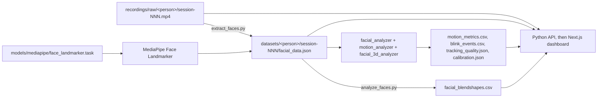
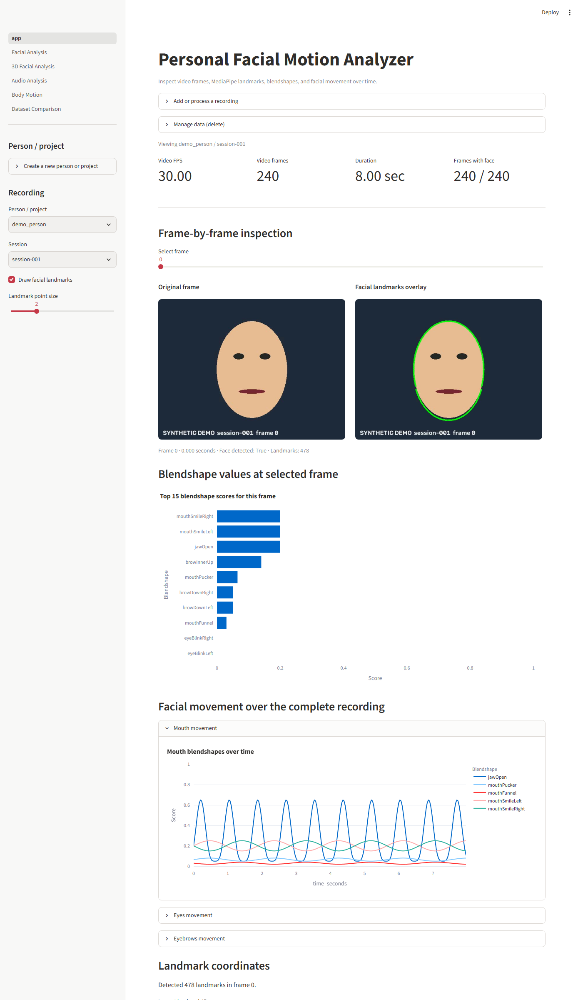
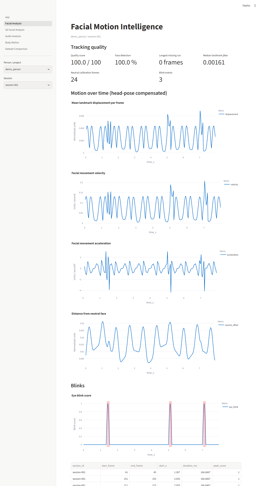

# Facial Analysis

A research tool for measuring facial motion from video. It uses MediaPipe Face Landmarker to
extract 478 face landmarks, 52-category blendshape scores and facial transformation matrices
for every frame. It then computes motion and tracking-quality measures and shows them in a
web dashboard (Next.js, with a Python API). It is intended as groundwork for personalised AI digital humans. Model
training is not implemented yet.

> **Privacy:** this project works with facial data. Keep your recordings and datasets out of
> any public repository. The examples and screenshots here use synthetic demo data only.

## Status

| Area | Status |
|---|---|
| Face landmark extraction (478 landmarks, blendshapes, transformation matrices) | Implemented |
| JSON and CSV export, one dataset per recording session | Implemented |
| Motion analysis: head-pose compensation, neutral calibration, displacement, velocity, acceleration | Implemented |
| Blink detection and tracking-quality metrics | Implemented |
| Next.js dashboard (`web/`) with the Python API (`api/`): people and sessions, add or process recordings, delete data, analysis pages | Implemented. The Streamlit dashboard was removed in phase P7 |
| Overwrite protection (`--force` for analysis, never for extraction) | Implemented |
| Synthetic demo data generator | Implemented |
| Pose data schema and session writer (staging, manifest, lock, recovery, rollback) | Implemented |
| Shared video frame reader | Implemented |
| Model registry with SHA-256 verification before loading | Implemented |
| Pose Landmarker extraction (FULL model, single subject) and pose data session assembly | **Implemented, tested with synthetic data and a fake detector; not validated on real recordings** |
| Pose data command-line entry point (`src/extraction/build_pose_session.py`) | **Implemented, tested with synthetic data; not run on a real recording** |
| Rollback of a run's pose data output when a face data file changes during processing | Implemented (CLI, exit code 4) |
| Next.js migration, phase P0: read-only Python API (`api/`) for health, persons and sessions | **Implemented, tested with synthetic data.** Read-only; binds to 127.0.0.1 when run. The web app and later phases are planned ([docs/proposals/nextjs_migration.md](docs/proposals/nextjs_migration.md)) |
| Next.js migration, phase P1: read-only web shell (`web/`) with Overview, People, sessions and Recordings | **Implemented, built and checked in a browser on local data.** Read-only. Run it with `npm ci` then `npm run dev` in `web/`, with the API on 127.0.0.1:8000 |
| Hand motion analysis (H1 to H6): landmarks, tracking, motion, rule-based gestures, validation, Hands page | **Implemented and tested with synthetic data. Not validated on labelled footage; gesture rules are uncalibrated. Browser check of the Hands page not yet done.** See the Hand motion section |
| Face-to-pose migration command | **Not implemented** |
| Next.js migration, phase P2: facial analysis, diagnostics and dataset comparison pages (`web/`) on read-only `/api` routes for face data. Charts use ECharts 6.1.0 | **Implemented, typechecked and built. Browser check on local data pending** |
| Next.js migration, phase P3: 3D facial page and Body Motion page (`web/`) on read-only `/api` routes for head pose and pose data Pose data. Body overlay is drawn by the API from the stored video (same code as the Streamlit page) | **Implemented, typechecked, built, tested with synthetic data and checked on a real pose data session in headless Chrome.** 3D is a projection, not a rotatable model (see below) |
| Next.js migration, phase P4: job system for pose data builds (`api/jobs.py`). Jobs run the existing CLI build in a separate process; one active job per session; cancel; restart marks unfinished jobs interrupted and reports leftovers, never removes them. Mutating routes need the API token. Web Jobs page (`/jobs`): token entry (kept for the tab only), start, live list and cancel. Kinds: Pose data build, face data face extraction (per-frame progress, face model checked before queueing, never overwrites), face data analysis outputs. Web Jobs page (`/jobs`) with a kind selector. No SSE yet | **Implemented and tested with a fake worker (26 tests). Real pose data build run on sameer_gupta/session-001 succeeded (62 frames, face data unchanged). Face data kinds not yet run for real** |
| Next.js migration, phase P5: Models (hash status against the registry, licence text as recorded), Logs (job worker output, project and home paths redacted) and Settings (names only, no token). Read-only, `api/system.py` | **Implemented, tested (11 tests), checked live: all three model hashes match, and rendered in headless Chrome** |
| Next.js migration, phase P6: Audio and Hands pages show their status (`/api/layers`) and what is needed, until the extractors exist. No audio or hand data is shown | **Implemented as placeholders (tested; pages built)** |
| Body Motion (Pose data Pose) dashboard page | **Implemented as a read-only viewer** of existing pose data sessions: overlay, visibility threshold, timeline, joints and quality. It does not generate pose data. Hand view not implemented. |
| Native video playback with synchronised facial, pose and hand landmark overlays (H8.2 to H8.5) | **Implemented.** Checked manually in the browser for playback, seeking, speed, session switching and overlays. Browser CPU, memory and rendering performance not measured. Localhost only. See the Video playback section |
| Model licence clearance for commercial use or redistribution | **Not cleared.** Pose FULL is partly verified; Face and Hand are unverified. See [THIRD_PARTY_NOTICES.md](THIRD_PARTY_NOTICES.md) |
| Audio acquisition, phase H9.1 (session audio from the video or a WAV/MP3 file, manifest, lock, limits) | **Implemented (tests with synthetic audio; not validated on real recordings beyond one 2 s session)** |
| Audio preprocessing and basic features, phase H9.2 (resampling, mono downmix, 10 ms energy, experimental pitch, energy-based VAD) | **Implemented (synthetic tests; no speech accuracy claimed)** |
| Audio ASR, alignment, phonemes, Audio page | **Not implemented** (H9.3 onwards; the dashboard page is a placeholder) |
| Body pose analysis | **Not implemented** (dashboard page is a placeholder) |
| Neural network training and inference | **Not implemented** (`src/training/`, `src/inference/` are empty) |

## Architecture



Folder layout:

```text
facial-analysis/
├── src/
│   ├── analysis/          extraction, analysis and shared helpers (scripts and modules)
│   │   ├── extract_faces.py       MediaPipe extraction for one session
│   │   ├── analyze_faces.py       blendshape CSV and motion outputs for one session
│   │   ├── facial_analyzer.py     session loading, blinks, quality, per-frame metrics
│   │   ├── motion_analyzer.py     head-pose compensation, calibration, kinematics
│   │   ├── facial_3d_analyzer.py  head pose angles, 3D frame data
│   │   ├── visualization.py       Plotly figure builders
│   │   ├── validation.py          landmark and timestamp checks
│   │   ├── file_safety.py         overwrite checks and atomic writes
│   │   ├── project_paths.py       folder layout and name rules
│   │   └── demo_data.py           synthetic demo recordings and datasets
│   ├── viewer/            overlay.py and pose_viewer.py (used by the API; no web framework)
│   ├── extraction/        reserved for audio and body extractors (empty)
│   ├── inference/         reserved for generation (empty)
│   └── training/          reserved for model training (empty)
├── tests/                 test_fixtures.py (synthetic), test_regression.py
├── docs/screenshots/      dashboard images made from synthetic data
├── models/mediapipe/      place face_landmarker.task here (not included)
├── recordings/raw/        your videos, one folder per person (not included)
└── datasets/              generated outputs, one folder per person (not included)
```

## Requirements

- **Python 3.11** (the only version tested so far)
- Windows 11 is the tested platform.
- Linux and macOS: not yet verified. The GitHub Actions workflow runs the tests on
  Ubuntu; the result is shown on the Actions tab.
- A GPU is not required. Extraction runs on the CPU.

## Installation

Run these in PowerShell from the project folder:

```powershell
python -m venv .venv
.\.venv\Scripts\Activate.ps1
pip install -r requirements.txt
```

Activate the environment again in each new terminal. `requirements.txt` installs
`opencv-contrib-python`, not `opencv-python`. MediaPipe depends on the contrib build, and
installing both causes conflicts.

### MediaPipe model

Download `face_landmarker.task` from the official MediaPipe Face Landmarker page and place it
at `models/mediapipe/face_landmarker.task`. The model is **not** included in this repository.
See [THIRD_PARTY_NOTICES.md](THIRD_PARTY_NOTICES.md) for licensing.

## Quick start with synthetic demo data

No recordings are needed to try the dashboard.

```powershell
python src/analysis/demo_data.py .\demo_data
$env:FACIAL_DATA_HOME = (Resolve-Path .\demo_data)
.\.venv\Scripts\uvicorn.exe api.main:app --host 127.0.0.1 --port 8000
# in a second terminal, in web/:
npm ci
npm run dev
```

Open http://localhost:3000.

The demo writes three synthetic sessions for `demo_person` into `demo_data/`. The videos show a
drawn cartoon face, and the landmarks are computed from the same geometry. The demo never
writes into the project's own `recordings/` or `datasets/` folders.

## Using your own recordings

1. Put each video in its own person folder, named `session-NNN.mp4`:
   ```text
   recordings/raw/<person>/session-001.mp4
   ```
   Person or project names may use lowercase letters, numbers, hyphens and underscores.
2. Extract the landmarks for the session:
   ```powershell
   python src/analysis/extract_faces.py <person> session-001
   ```
3. Write the analysis outputs:
   ```powershell
   python src/analysis/analyze_faces.py <person> session-001
   ```
4. Start the API and the web dashboard (see the quick start), then select the person and session.

The Jobs page does steps 2 and 3 for you. Recordings and People pages can upload a video, rename,
and delete sessions or people.

### Overwrite protection

- **Extraction never overwrites a dataset.** If `facial_data.json` or frame images already
  exist for a session, the script stops. To regenerate, delete that session's dataset first
  (dashboard **Manage data**, or delete the folder by hand).
- **Analysis refuses to overwrite** existing outputs unless you pass `--force`:
  ```powershell
  python src/analysis/analyze_faces.py <person> session-001 --force
  ```
- Analysis never modifies `facial_data.json` or the recording.

## Pose data command line (implemented; not validated on real recordings)

```powershell
python src/extraction/build_pose_session.py <person> <session> [--regenerate] [--models-dir DIR]
```

- It processes an existing face data session. The face data facial data (`facial_data.json`) must already exist.
- It verifies the Pose FULL model's SHA-256 before loading it. A missing or altered model is refused.
- An existing pose dataset is refused unless `--regenerate` is given. The previous pose dataset is kept, so it can be restored.
- face data files and the original video are never written.
- If a face data file changes during the run, the CLI rolls back that run's pose data output. It restores the previous pose dataset if there was one, and otherwise removes the new pose data files. A refused or failed rollback is reported, and the files are left in place.
- Exit codes: `0` published; `1` processing failed; `2` refused before processing; `3` model missing or wrong; `4` a face data file changed (rollback attempted).

Automated tests use synthetic data and a fake detector. Real-recording validation has not been done.

## Hand motion analysis (implemented; not calibrated)

Runs on a recording that already has pose data. Hand data are written into the same session folder, in the `hands/`
stream, through the same atomic writer. Face and pose data are never rebuilt by it.

**Requirements.** The same Python 3.11 environment as the rest of the project. The Hand Landmarker model file
`models/mediapipe/hand_landmarker.task` must be present and match the SHA-256 in `src/extraction/model_registry.py`.
The model is not included in the repository. Its licence is recorded as **UNVERIFIED** in the registry; this is
recorded metadata, not clearance for commercial use or redistribution.

**Workflow.** From the Hands page, or from the command line:

```powershell
python src/extraction/build_hand_pipeline.py <person> <session> [--regenerate]
```

This runs, in order: landmarks (`build_hand_session.py`, H1), tracking and motion (`analyse_hand_session.py`, H2),
gesture classification (`classify_hand_gestures.py`, H3), and read-only validation (`validation`, H4). Each stage
publishes its own complete state. A stage that fails stops the run. Existing hand outputs are kept unless
`--regenerate` is given.

**Landmarks (H1).** MediaPipe Hand Landmarker in VIDEO mode, up to two hands. 21 points per hand, normalised image
coordinates, plus world coordinates (metres) where the model provides them. Each frame has a status per side:
`valid`, `low_confidence` (handedness score below 0.7; kept but not tracked), `outside_frame` (some landmarks lie off
the image; this is not an occlusion measure), `not_detected`, `unassigned` (a hand was found but its side was ambiguous),
or `not_processed`. Left and right come from the model's label; a label used twice in one frame is not guessed.

**Tracking (H2).** Per frame, each usable hand is linked to a track by its distance from the predicted centroid, measured
in hand sizes, with a penalty when the label differs. Links are chosen by exhaustive minimum cost. Tracks record creation,
interruption (first missing frame), reacquisition, and termination (after more than 5 missing frames, or end of recording).
Uncertain links are flagged (`label_conflict`, `ambiguous_candidates`, `hands_close`), not hidden. There is no appearance
model, so crossing hands can be linked to the wrong track; the flags say when that is possible, not that it happened.

**Motion metrics (H2).** Units are image pixels (normalised x times width, y times height), velocity in pixels per second,
acceleration in pixels per second squared, angles in degrees, openness as a ratio. Pixel measures are image-space, not
physical distances, and pixel speed is not physical hand speed. No smoothing. Velocity is not computed across a gap in
the track; a missing value is recorded as missing, never as zero.

**Gesture rules (H3).** Each finger is `extended`, `curled` or `unknown` from its reach (tip distance from the wrist, in
palm lengths) and joint angles. Classes: `open_palm`, `closed_fist`, `pointing`, `thumbs_up`, `peace`, `unknown`. A class
needs every finger determinate. Left and right labels are not used, so mirrored input gives the same class. The
thresholds were set from synthetic geometry and one template hand. They are **not calibrated on labelled footage**.
A stable gesture event needs at least 5 supporting frames; up to 2 unknown or other-class frames are bridged inside one
event; longer changes end it; a missing frame always ends it. The geometric margin is a rule distance, not a probability.

**Validation (H4).** `python src/extraction/validate_hand_session.py <person> <session> [--json PATH]` checks the H1 to H3
outputs against each other, the manifest checksums and the metadata (including the model hash). It reports errors
(the data contradict each other) and warnings (consistent but questionable). It never repairs or rewrites files.
Passing these checks means the files are consistent. It does **not** mean the landmarks or gesture labels are correct.

**Annotations (evaluation only).** Manual gesture labels are kept apart from classifier output. Format and validation are
in `src/analysis/hand_annotation.py`: one row per labelled interval, with the track or hand, frame range, gesture label
(`open_palm`, `closed_fist`, `pointing`, `thumbs_up`, `peace`, `unknown`, `occluded`), visibility, certainty, annotator and
annotation version. The `annotations/` folder is git-ignored. Evaluation (precision, recall, F1, confusion matrix, unknown
rate, fully versus partly visible) is in `src/analysis/hand_evaluation.py`. No labelled data exists yet, so no accuracy
figure is reported anywhere in this repository.

**Dataset outputs** (inside `datasets/<person>/<session>/`):

| File | Content |
|---|---|
| `hands/left_hand.npy`, `hands/right_hand.npy` | normalised landmarks, frames × 21 × 3 (float32) |
| `hands/left_hand_world.npy`, `hands/right_hand_world.npy` | world landmarks in metres (NaN where not given) |
| `hands/hand_status.csv`, `hands/handedness.csv` | per-frame status and detection flags |
| `hands/tracks.csv` | track events: created, matched, reacquired, interrupted, terminated |
| `hands/motion_metrics.csv` | one row per linked observation, with the metrics above |
| `hands/gesture_observations.csv`, `hands/gesture_events.csv` | frame-level classes and stable events |
| `quality/tracking_quality.json` | `hands` section: detection, tracking, motion and gesture summaries |
| `manifest.json`, `metadata.json` | checksums, extractor and model provenance, configuration |

**API and Hands page.** Job kind `hand_build` (token required to start or cancel). Read-only routes under
`/api/persons/{person}/sessions/{session}/hands/`: `summary`, `landmarks` (at most 100 frames per page), `tracks`,
`motion`, `gestures/observations`, `gestures/events` (at most 200 rows per page), `quality/{tracking|gestures}`,
`validation`, and `frames/{index}/overlay.jpg`. The read routes have no token, as the other read routes do, so the API
must stay bound to `127.0.0.1`. The Hands page at `/hands` runs the job, shows each stage, plays the frames, and shows the
motion, gesture and quality results.

**Known limitations.** Gesture accuracy is unknown and uncalibrated. The per-frame detection score is not exposed by the
API, so the page shows status only. Validation reads the whole session and takes about a second on the test recording.
Charts and filters load at most 5,000 rows. Browser verification of the Hands page is not yet done. No Audio, phoneme
alignment, multimodal timeline, training or inference is included.

## Video playback and landmark overlays (H8)

The Hands page plays the original recording in the browser's own video element, and draws the extracted landmarks over
it, synchronised with the frame on screen. Nothing is re-extracted during playback.

**What is streamed.** The original `.mp4` from `recordings/raw/<person>/<session>.mp4`, served by
`GET /api/persons/{person}/sessions/{session}/video` with HTTP Range support (partial responses are 206, with the correct
`Content-Range`). The file is never copied, re-encoded or written. Responses carry `Cache-Control: no-store`.

**Landmark windows (HLW1, version 1).** `GET /api/persons/{person}/sessions/{session}/landmarks/window?start=&count=`
returns between 1 and 30 consecutive frames of all four landmark streams in one binary response:

| Bytes | Content |
|---|---|
| 0 to 3 | magic `HLW1` |
| 4 to 7 | `uint32` (little-endian) length N of the JSON header |
| 8 to 8+N | UTF-8 JSON header: format, version, frame indexes, timestamps, per-frame face, pose and hand flags, hand status, and each stream's channels, shape, dtype, byte offset and byte count |
| after the header | the stream arrays, `float32`, C order, little-endian; offsets are relative to the start of this data section |

Stream shapes are `[frames, points, channels]`: face 478 points (x, y); body 33 points (x, y, visibility); left and right
hands 21 points each (x, y). Coordinates are normalised image coordinates (x divided by the frame width, y by the frame
height). Missing values are NaN. A stream that is not in the session is declared absent, with a reason, and is not drawn.
The browser parser (`web/app/lib/hlw1.ts`) rejects any window whose magic, version, frame count, timestamps, shapes,
byte counts, offsets or values do not match this layout. A rejected window is shown as an error; nothing is drawn from it.

**Synchronisation.** Each presented video frame's media time (from `requestVideoFrameCallback`, or the video's
`currentTime` where that is unavailable) is mapped to the last frame of the extracted timeline at or before it, with a
tolerance of half a millisecond. The frame index is never calculated as `currentTime x fps`. The frame's landmarks come
from the window cache. Playback is never paused to wait for landmark data.

**Timing check.** `GET .../video/timing` decodes the recording and compares each frame's decoded time with the extracted
timeline. It returns `synchronized` only if every frame was checked and every difference is within 2 ms. It returns
`deviation` or `unavailable` otherwise. Landmark overlays stay off unless the status is `synchronized`; the video plays
normally in every case. The check decodes the whole recording once per process, which takes about 3.7 s for a 1,273-frame
recording; the result is cached in memory, keyed on the file's path, size and modification time. Recordings longer than
12,000 frames are reported `unavailable`. The timing check is not persisted between runs.

**Cache and prefetch.** The browser keeps at most eight windows of 30 frames (about 1.1 MB for the full set). The window
containing the current frame is loaded, and the next and previous windows are prefetched when they exist. A window that
starts past the last frame is not requested. Requests for the same window are shared. Network failures are retried
twice; HTTP and format errors are not retried and are shown as an error. Clearing the cache (on session change or page
exit) aborts requests in flight.

**Overlays.** The overlay is one canvas, the same size as the video element's own box, so it cannot be stretched separately
from the picture. It is drawn at the device pixel ratio. Each stream has a visibility control and a colour: face cyan,
body teal, left hand light blue, right hand pink. Points that are missing or not finite are skipped, and no line is drawn
to a missing point. Body points below visibility 0.5 are not drawn.

**Security.** The API is bound to `127.0.0.1`. The video and landmark routes accept a request only when:

- the `Host` header is `127.0.0.1:8000` or `localhost:8000`, or the names set in `FACIAL_ALLOWED_HOSTS` (comma separated).
  `X-Forwarded-Host` is never read. The Next.js proxy sends the API's own address as `Host`, so proxied requests pass;
- the `Sec-Fetch-Site` header is absent (non-browser clients) or `same-origin`. `same-site`, `cross-site` and `none` are refused.

Names are validated before any file is opened. The recording path is resolved and must lie inside the recordings root,
which refuses symlinks that point elsewhere. Error responses carry a code and a message, never a filesystem path. The
startup log names the token's location in words only; the token itself is never logged. The routes are read-only.

**Privacy limitations.** Localhost binding is a deployment restriction, not protection against other software on the same
machine, which can reach the same port. Requests without a `Sec-Fetch-Site` header are accepted by design, so any local tool
can read the recordings and landmarks. The API is not approved for public or shared-network deployment, and no
authentication is added to the read routes.

**Verified and not verified.**

- Verified by automated tests: the guard (Host, Sec-Fetch-Site, forwarded headers), Range responses, path and symlink
  refusal, the window format and limits, the timing states, and the read-only behaviour (31 video tests, all passing).
- Verified against real data: a window served through the proxy matches the stored NumPy values; the timing check on two
  real recordings reported `synchronized`.
- Verified manually in the browser by the project owner: playback, pause, seeking, speed control, session switching, and
  the overlays on frames.
- Not measured: browser CPU, memory and rendering performance; first-landmark latency in the browser; behaviour on
  recordings longer than the 1,273-frame test recording.
- Not verified: variable-frame-rate recordings. The timing check decides each recording on its own evidence, so a
  recording that fails it stays unsynchronised. The mapping was checked on constant-frame-rate recordings only.
- Not implemented: a persistent timing-validation cache; a per-frame detection score in the API (so the page shows
  detection status, not a score); frame numbers shown during playback.

## Audio acquisition and features (H9.1, H9.2)

Audio is stored per session in `datasets/<person>/<session>/audio/`, separate from the pose data. Original videos
and external files are never modified.

**Commands** (run from the project root; the analysis run needs the acquisition run first):

```
python src/extraction/build_audio_session.py <person> <session> [--external FILE.wav|FILE.mp3] [--stream N]
                                             [--offset-us N] [--retain] [--force] [--clear-stale-lock]
python src/extraction/build_audio_features.py <person> <session> [--external FILE] [--regenerate]
                                             [--analysis-rate HZ] [--window-ms MS] [--hop-ms MS]
                                             [--pitch-min-hz HZ] [--pitch-max-hz HZ] [--pitch-threshold X]
                                             [--silence-db DB] [--vad-db DB] [--vad-min-speech-ms MS]
                                             [--vad-min-silence-ms MS] [--vad-merge-gap-ms MS]
```

Acquisition (H9.1) reads the first audio stream of the recording, or the file given with `--external`. It writes
`audio/manifest.json` only. Limits: 2 GB source, 4 hours of audio, and 3 GiB of decoded PCM. A per-session lock
(`audio/.acquire.lock`) stops two runs from overlapping. A stale lock is reported and is never removed
automatically; `--clear-stale-lock` removes it only after confirming the owning process has stopped.

Processing (H9.2) needs the H9.1 manifest. It checks the source's SHA-256 first. An external file that H9.1 did not
retain must be supplied again with `--external`. It runs under the same lock, and it never runs acquisition itself.

**Preprocessing.** FFmpeg decodes the selected stream, mixes it to mono and resamples it to the analysis rate
(default 16 kHz), producing 32-bit float in a temporary file that is deleted afterwards. The downmix is an equal-weight
mean of all channels, written as an explicit `pan` expression. Every channel counts, including any LFE channel, so
the result is a simple analysis baseline. It is not a broadcast downmix. The resampler is FFmpeg's default
(windowed sinc). Its version is recorded in the metadata. The analysis signal is read in blocks, so memory grows
with the number of frames, not the length of the audio. The analysis signal is limited to 1 GiB, which is about
four hours at 16 kHz. The size is checked before decoding and watched while FFmpeg runs.

**Timing.** Session time is an integer number of microseconds:

    session_us(j) = audio_start_us + round(j * 1e6 / analysis_rate) + external_offset_us - origin_us

`audio_start_us` is the first audio timestamp from the probe. `origin_us` is the first video timestamp, or 0 when
there is no video. `external_offset_us` is positive when the external audio starts later on the session clock. An
offset is refused for embedded audio. A frame's reference time is its window centre, sample
`i * hop + window // 2`.

**Frames.** Window 40 ms, hop 10 ms (both configurable). A frame is emitted only when its whole window lies inside
the signal. Leftover samples at the end are reported, not padded.

**Energy.** `rms` is linear with full scale 1.0. `energy_db` is in dBFS with a floor of -120 dB. A frame below -50 dBFS is
marked silent.

**Pitch (experimental).** Normalised cross-correlation over lags covering 60 to 400 Hz, choosing a local maximum within
90% of the best peak, with parabolic refinement. Voiced needs correlation of at least 0.6 and a non-silent frame.
Synthetic tones at 90 to 380 Hz are estimated within 0.02 Hz, and white noise is not treated as voiced. That does
not establish pitch accuracy for speech, for any speaker, language or recording condition. Octave errors are
possible. The estimator is isolated so that it can be replaced.

**Voice activity (baseline).** Energy-based: speech when `energy_db` is at or above -40 dBFS. Gaps up to 200 ms are
merged, speech shorter than 100 ms is dropped, and silence of at least 200 ms is reported. Boundaries are at 10 ms
resolution. This is not ground truth and has not been evaluated against any annotation. The thresholds are
absolute, so they depend on recording gain.

**Outputs.** Written to `audio/`, and documented in `src/extraction/audio_processing.py`:

| File | Content |
|---|---|
| `manifest.json` (H9.1) | source, streams, decoded counts, duration check, timeline, retention |
| `features/audio_features.csv` | per frame: start and centre samples, `t_us`, `rms`, `energy_db`, `pitch_status` (voiced, unvoiced or silent), `f0_hz` (empty when not voiced), `f0_confidence` |
| `features/feature_metadata.json` | configuration, timeline base, preprocessing record (rates, counts, downmix expression, resampler, FFmpeg version) |
| `vad/vad_frames.csv` | per frame speech decision |
| `vad/vad_segments.csv` | speech and silence segments, in samples and microseconds |
| `vad/vad_metadata.json` | VAD rule and configuration |
| `quality/audio_quality.json` | technical measurements only: lengths, peak, RMS, clipping, silence, voiced and speech ratios |
| `processing_manifest.json` | written last; lists each published file with its SHA-256 |

Outputs are staged, read back and checked, then moved into place. An existing output is refused unless `--regenerate`
is given. A regeneration moves the old outputs and the old `processing_manifest.json` aside, and restores them if
publication fails. Interrupted runs leave no valid completion marker.

**Not in H9.2.** Speech recognition, language identification, G2P, phoneme alignment, neural VAD, the API, the
Audio page and any real-speech accuracy measurement.

**Performance (synthetic, stereo 44.1 kHz).** A 10-minute input takes about 0.5 s to acquire and about 56 s to
process, roughly 10.6 times real time, with a peak process memory of about 76 MB (fresh process). This is not measured
on a long real recording: the only real session in the project is 2 seconds long. Processing time for one hour is an
extrapolation, not a measurement.

**Limitations.**
- No labelled speech data exists, so no accuracy claim is made for pitch, VAD or any transcript.
- The downmix is an equal-weight mean, not a standards-based downmix.
- The pitch estimator is experimental.
- Temporary disk use is about 4 bytes per analysis sample while processing; it is deleted afterwards.
- The whole source is hashed on each processing run, which adds time for large files.

**Tests.** `tests/test_audio_acquisition.py` (64), `tests/test_audio_signal.py` (32) and `tests/test_audio_processing.py`
(32). Setting `AUDIO_TESTS_REQUIRE_FFMPEG=1` is recommended for CI, so that a missing FFmpeg fails instead of skipping; CI is not yet configured with it. Without it, the
FFmpeg-dependent tests are skipped and the reason is printed.

## Dashboard



| Page | Contents |
|---|---|
| Main | Add or process a recording, delete data, frame viewer with a landmark overlay (Hybrid, Wireframe, Contours, Points or Off, with opacity, thickness and point-size controls), blendshape bars, movement charts, landmark coordinates |
| 01 Facial Analysis | Tracking quality, displacement, velocity, acceleration, neutral-face offset, blinks, head pose, jaw and mouth |
| 02 3D Facial Analysis | 3D landmark view (raw or head-pose compensated), head pose angles, depth span |
| 03 Audio Analysis | Placeholder. Not implemented |
| 04 Body Motion | Read-only viewer of existing pose data sessions (pose overlay, visibility threshold, detection timeline, joint table, tracking quality). Shows only sessions that pass the pose data metadata and manifest checks. Does not generate pose data. |
| 05 Dataset Comparison | Compares the processed sessions of one person: summary, blendshape means, distributions, landmark stability |
| 06 Diagnostics | Tracking checks, interruptions, neutral-frame selection, raw versus compensated landmarks, head rotation, displacement, velocity, acceleration |




## Outputs and dataset files

Each session folder `datasets/<person>/session-NNN/` contains:

| File | Contents |
|---|---|
| `facial_data.json` | One object per frame: `frame`, `timestamp_ms`, `face_detected`, and when a face is found, `landmarks` (478 items with `id`, `x`, `y`, `z`), `blendshapes` (name to score) and `transformation_matrix` (4×4). Written by extraction and never modified afterwards. |
| `facial_blendshapes.csv` | One row per frame: `frame`, `timestamp_ms`, `face_detected`, then one column per blendshape. |
| `frames/` | Annotated JPEG frames with landmarks drawn (created by extraction). |
| `motion_metrics.csv` | One row per frame with `session_id`, `time_s`, `face_detected`, `neutral_offset`, `displacement`, `velocity`, `acceleration`, `jaw_open`, `mouth_activity`, `eye_blink`, `brow_inner_up`, `yaw_deg`, `pitch_deg`, `roll_deg`. |
| `blink_events.csv` | One row per blink: `start_frame`, `end_frame`, `start_s`, `duration_ms`, `peak_score`. |
| `tracking_quality.json` | Detection rate, longest run without a face, median landmark jitter and a quality score. |
| `calibration.json` | Number of neutral frames used and the calibration method. |

Each person folder also has `dataset_metadata.json`, which lists the processed sessions with
their frame counts and frame rates.

The pose data layout (Pose and pose data metadata, manifest, licence notes) is described in
[docs/dataset_layout.md](docs/dataset_layout.md).

### Example row (synthetic data, shortened)

`facial_blendshapes.csv`:

```text
frame,timestamp_ms,face_detected,jawOpen,mouthSmileLeft,...,eyeBlinkLeft,...
0,0,True,0.1,0.15,...,0.05,...
```

## Measurement notes and limitations

The conventions, formulas, the empirical convention check and the limitations are documented in
[docs/validation.md](docs/validation.md). The head-pose axis-flip convention is **empirically
supported** by three local sessions from two people. It is not an established MediaPipe guarantee
and has not been checked against an independently measured head rotation.

- **Head-pose compensation removes rotation only.** Translation and scale are not removed.
  Velocity and acceleration therefore measure shape change, not head movement.
- **Neutral-face calibration** uses the 10% of tracked frames with the least mouth, jaw, eye
  and brow activity. Short or expressive recordings may give a poor neutral face.
- **Blink detection** is a threshold on the mean eyeBlink score (0.5). It has not been
  validated against manual annotations.
- **Tracking quality** reflects detection and matrix availability only. It does not measure
  landmark accuracy.
- **Single face.** Extraction tracks one face (`num_faces=1`).
- **Frame-accurate alignment only.** The dashboard steps through frames. It does not
  synchronise a playing video with the charts.
- **Platforms.** Only Windows 11 with Python 3.11 has been tested locally.

## Tests

```powershell
python -m unittest tests.test_fixtures tests.test_regression tests.test_scientific -v
```

- `tests/test_scientific.py` checks head-pose compensation against known rotations, translations,
  scales and aspect ratios, and checks motion metrics against known movements (including
  irregular timestamps). See [docs/validation.md](docs/validation.md).

- `tests/test_fixtures.py` builds temporary synthetic sessions. It covers JSON loading, CSV
  generation, landmark and timestamp validation, dataset loading, overwrite protection and
  dataset immutability.
- `tests/test_regression.py` covers naming rules, motion calculations on synthetic data,
  deletion safety, script compilation, and a headless run of the dashboard. It also checks
  your local datasets when they exist, and skips those checks when they do not.

GitHub Actions runs both files on Windows and Ubuntu with Python 3.11. CI has no personal data,
so the local-dataset checks are skipped there.

## Roadmap

Planned, not implemented:

1. Audio feature extraction aligned to video frames (`src/extraction/audio_extractor.py`).
2. Body pose extraction (`src/extraction/body_extractor.py`).
3. Facial motion dataset builder and audio-to-motion model (`src/training/`).
4. Inference and video generation (`src/inference/`).
5. Validation of blink detection and calibration against manual labels.

## License

This project's code is licensed under the Apache License 2.0. See [LICENSE](LICENSE). Third-party
components and the MediaPipe model are covered in [THIRD_PARTY_NOTICES.md](THIRD_PARTY_NOTICES.md).

## Contributing

See [CONTRIBUTING.md](CONTRIBUTING.md). Please do not include personal recordings or datasets
in issues or pull requests. Changes are listed in [CHANGELOG.md](CHANGELOG.md).
