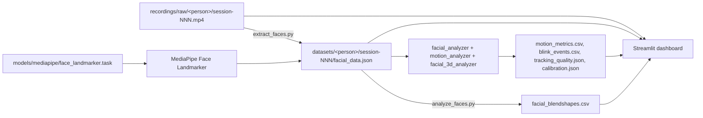
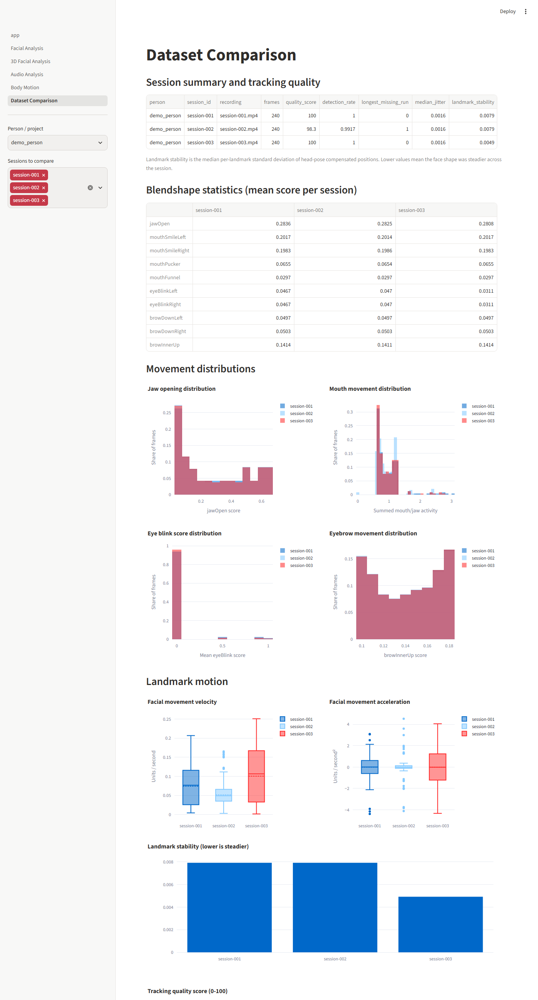

# Facial Analysis

A research tool for measuring facial motion from video. It uses MediaPipe Face Landmarker to
extract 478 face landmarks, 52-category blendshape scores and facial transformation matrices
for every frame. It then computes motion and tracking-quality measures and shows them in a
Streamlit dashboard. It is intended as groundwork for personalised AI digital humans. Model
training is not implemented yet.

> **Privacy:** this project works with facial data. Keep your recordings and datasets out of
> any public repository. The examples and screenshots here use synthetic demo data only.

## Status

| Area | Status |
|---|---|
| Face landmark extraction (478 landmarks, blendshapes, transformation matrices) | Implemented |
| JSON and CSV export, one dataset per recording session | Implemented |
| Motion analysis: head-pose compensation, neutral calibration, displacement, velocity, acceleration | Implemented |
| Blink detection and tracking-quality metrics | Implemented |
| Streamlit dashboard: people and sessions, add or process recordings, delete data, five pages | Implemented |
| Overwrite protection (`--force` for analysis, never for extraction) | Implemented |
| Synthetic demo data generator | Implemented |
| Audio feature analysis | **Not implemented** (dashboard page is a placeholder) |
| Body pose analysis | **Not implemented** (dashboard page is a placeholder) |
| Neural network training and inference | **Not implemented** (`src/training/`, `src/inference/` are empty) |

## Architecture



Folder layout:

```text
facial-analysis/
├── src/
│   ├── analysis/          extraction, analysis and shared helpers (scripts and modules)
│   │   ├── extract_faces.py       MediaPipe extraction for one session
│   │   ├── analyze_faces.py       blendshape CSV and motion outputs for one session
│   │   ├── facial_analyzer.py     session loading, blinks, quality, per-frame metrics
│   │   ├── motion_analyzer.py     head-pose compensation, calibration, kinematics
│   │   ├── facial_3d_analyzer.py  head pose angles, 3D frame data
│   │   ├── visualization.py       Plotly figure builders
│   │   ├── validation.py          landmark and timestamp checks
│   │   ├── file_safety.py         overwrite checks and atomic writes
│   │   ├── project_paths.py       folder layout and name rules
│   │   └── demo_data.py           synthetic demo recordings and datasets
│   ├── dashboard/         Streamlit app (app.py) and pages/
│   ├── extraction/        reserved for audio and body extractors (empty)
│   ├── inference/         reserved for generation (empty)
│   └── training/          reserved for model training (empty)
├── tests/                 test_fixtures.py (synthetic), test_regression.py
├── docs/screenshots/      dashboard images made from synthetic data
├── models/mediapipe/      place face_landmarker.task here (not included)
├── recordings/raw/        your videos, one folder per person (not included)
└── datasets/              generated outputs, one folder per person (not included)
```

## Requirements

- **Python 3.11** (the only version tested so far)
- Windows 11 is the tested platform.
- Linux and macOS: not yet verified. The GitHub Actions workflow runs the tests on
  Ubuntu; the result is shown on the Actions tab.
- A GPU is not required. Extraction runs on the CPU.

## Installation

Run these in PowerShell from the project folder:

```powershell
python -m venv .venv
.\.venv\Scripts\Activate.ps1
pip install -r requirements.txt
```

Activate the environment again in each new terminal. `requirements.txt` installs
`opencv-contrib-python`, not `opencv-python`. MediaPipe depends on the contrib build, and
installing both causes conflicts.

### MediaPipe model

Download `face_landmarker.task` from the official MediaPipe Face Landmarker page and place it
at `models/mediapipe/face_landmarker.task`. The model is **not** included in this repository.
See [THIRD_PARTY_NOTICES.md](THIRD_PARTY_NOTICES.md) for licensing.

## Quick start with synthetic demo data

No recordings are needed to try the dashboard.

```powershell
python src/analysis/demo_data.py .\demo_data
$env:FACIAL_DATA_HOME = (Resolve-Path .\demo_data)
streamlit run src\dashboard\app.py
```

The demo writes three synthetic sessions for `demo_person` into `demo_data/`. The videos show a
drawn cartoon face, and the landmarks are computed from the same geometry. The demo never
writes into the project's own `recordings/` or `datasets/` folders.

## Using your own recordings

1. Put each video in its own person folder, named `session-NNN.mp4`:
   ```text
   recordings/raw/<person>/session-001.mp4
   ```
   Person or project names may use lowercase letters, numbers, hyphens and underscores.
2. Extract the landmarks for the session:
   ```powershell
   python src/analysis/extract_faces.py <person> session-001
   ```
3. Write the analysis outputs:
   ```powershell
   python src/analysis/analyze_faces.py <person> session-001
   ```
4. Start the dashboard and select the person and session:
   ```powershell
   streamlit run src\dashboard\app.py
   ```

The dashboard does steps 2 and 3 for you when you choose **Add or process a recording**. It
can also upload a video and delete sessions or people (**Manage data**).

### Overwrite protection

- **Extraction never overwrites a dataset.** If `facial_data.json` or frame images already
  exist for a session, the script stops. To regenerate, delete that session's dataset first
  (dashboard **Manage data**, or delete the folder by hand).
- **Analysis refuses to overwrite** existing outputs unless you pass `--force`:
  ```powershell
  python src/analysis/analyze_faces.py <person> session-001 --force
  ```
- Analysis never modifies `facial_data.json` or the recording.

## Dashboard


| Page | Contents |
|---|---|
| Main | Add or process a recording, delete data, frame viewer with landmark overlay, blendshape bars, movement charts, landmark coordinates |
| 01 Facial Analysis | Tracking quality, displacement, velocity, acceleration, neutral-face offset, blinks, head pose, jaw and mouth |
| 02 3D Facial Analysis | 3D landmark view (raw or head-pose compensated), head pose angles, depth span |
| 03 Audio Analysis | Placeholder. Not implemented |
| 04 Body Motion | Placeholder. Not implemented |
| 05 Dataset Comparison | Compares the processed sessions of one person: summary, blendshape means, distributions, landmark stability |




## Outputs and dataset files

Each session folder `datasets/<person>/session-NNN/` contains:

| File | Contents |
|---|---|
| `facial_data.json` | One object per frame: `frame`, `timestamp_ms`, `face_detected`, and when a face is found, `landmarks` (478 items with `id`, `x`, `y`, `z`), `blendshapes` (name to score) and `transformation_matrix` (4×4). Written by extraction and never modified afterwards. |
| `facial_blendshapes.csv` | One row per frame: `frame`, `timestamp_ms`, `face_detected`, then one column per blendshape. |
| `frames/` | Annotated JPEG frames with landmarks drawn (created by extraction). |
| `motion_metrics.csv` | One row per frame with `session_id`, `time_s`, `face_detected`, `neutral_offset`, `displacement`, `velocity`, `acceleration`, `jaw_open`, `mouth_activity`, `eye_blink`, `brow_inner_up`, `yaw_deg`, `pitch_deg`, `roll_deg`. |
| `blink_events.csv` | One row per blink: `start_frame`, `end_frame`, `start_s`, `duration_ms`, `peak_score`. |
| `tracking_quality.json` | Detection rate, longest run without a face, median landmark jitter and a quality score. |
| `calibration.json` | Number of neutral frames used and the calibration method. |

Each person folder also has `dataset_metadata.json`, which lists the processed sessions with
their frame counts and frame rates.

### Example row (synthetic data, shortened)

`facial_blendshapes.csv`:

```text
frame,timestamp_ms,face_detected,jawOpen,mouthSmileLeft,...,eyeBlinkLeft,...
0,0,True,0.1,0.15,...,0.05,...
```

## Measurement notes and limitations

The conventions, formulas, the empirical convention check and the limitations are documented in
[docs/validation.md](docs/validation.md).

- **Head-pose compensation removes rotation only.** Translation and scale are not removed.
  Velocity and acceleration therefore measure shape change, not head movement.
- **Neutral-face calibration** uses the 10% of tracked frames with the least mouth, jaw, eye
  and brow activity. Short or expressive recordings may give a poor neutral face.
- **Blink detection** is a threshold on the mean eyeBlink score (0.5). It has not been
  validated against manual annotations.
- **Tracking quality** reflects detection and matrix availability only. It does not measure
  landmark accuracy.
- **Single face.** Extraction tracks one face (`num_faces=1`).
- **Frame-accurate alignment only.** The dashboard steps through frames. It does not
  synchronise a playing video with the charts.
- **Platforms.** Only Windows 11 with Python 3.11 has been tested locally.

## Tests

```powershell
python -m unittest tests.test_fixtures tests.test_regression tests.test_scientific -v
```

- `tests/test_scientific.py` checks head-pose compensation against known rotations, translations,
  scales and aspect ratios, and checks motion metrics against known movements (including
  irregular timestamps). See [docs/validation.md](docs/validation.md).

- `tests/test_fixtures.py` builds temporary synthetic sessions. It covers JSON loading, CSV
  generation, landmark and timestamp validation, dataset loading, overwrite protection and
  dataset immutability.
- `tests/test_regression.py` covers naming rules, motion calculations on synthetic data,
  deletion safety, script compilation, and a headless run of the dashboard. It also checks
  your local datasets when they exist, and skips those checks when they do not.

GitHub Actions runs both files on Windows and Ubuntu with Python 3.11. CI has no personal data,
so the local-dataset checks are skipped there.

## Roadmap

Planned, not implemented:

1. Audio feature extraction aligned to video frames (`src/extraction/audio_extractor.py`).
2. Body pose extraction (`src/extraction/body_extractor.py`).
3. Facial motion dataset builder and audio-to-motion model (`src/training/`).
4. Inference and video generation (`src/inference/`).
5. Validation of blink detection and calibration against manual labels.

## License

This project's code is licensed under the Apache License 2.0. See [LICENSE](LICENSE). Third-party
components and the MediaPipe model are covered in [THIRD_PARTY_NOTICES.md](THIRD_PARTY_NOTICES.md).

## Contributing

See [CONTRIBUTING.md](CONTRIBUTING.md). Please do not include personal recordings or datasets
in issues or pull requests. Changes are listed in [CHANGELOG.md](CHANGELOG.md).
